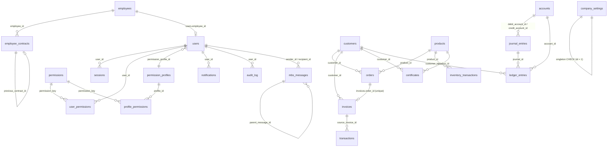

# Database relationship diagram — OLD @ `c2871d2`

Source of truth: `cloudflare/migrations/0001_mbs_core_schema.sql` (564 lines, 24 tables).
The local SQLite schema in `src/database/database.ts` (2,851 lines) is the same logical
model written in TypeScript.

## Declared foreign keys: two, in the whole schema

```sql
employee_contracts.employee_id        -> employees(id)
employee_contracts.previous_contract_id -> employee_contracts(id)
```

Everything else is **application-enforced**. There is a test for this
(`tests/main/entry-database-fk-integrity.ts`), which suggests integrity is maintained by
code plus that test rather than by the database.

## Entity-relationship diagram (conventional relationships, not declared FK)



## Table groups

| Group | Tables | Notes |
|---|---|---|
| Identity | `users`, `sessions`, `permissions`, `permission_profiles`, `user_permissions`, `profile_permissions` | `users.username` UNIQUE, `idx_users_single_owner` enforces exactly one owner |
| People | `employees`, `employee_contracts` | The only declared FKs |
| Catalogue | `products` | `product_id TEXT UNIQUE` |
| Parties | `customers` | `customer_id TEXT UNIQUE` |
| Trading | `orders`, `invoices`, `transactions` | `invoices.order_id` unique index; `transactions.source_invoice_id` |
| Stock | `inventory_transactions` | Append-only by convention |
| Finance | `accounts`, `journal_entries`, `ledger_entries` | `accounts.code` UNIQUE, `journal_entries.journal_id` UNIQUE |
| Documents | `certificates` | Not in the prompt's module list |
| Operations | `notifications`, `audit_log`, `mbs_messages` | `audit_log.record_id` is polymorphic |
| Settings | `company_settings` | **Physical singleton: `id INTEGER PRIMARY KEY CHECK (id = 1)`** |

## Structural defects that affect migration

1. **Mixed key types.** `users`, `employees`, `accounts`, `permission_profiles` use
   `INTEGER` ids; `products`, `customers`, `orders`, `invoices`, `certificates` use `TEXT`
   business keys. A cross-type join anywhere is a silent bug; the ETL must type-map each
   column explicitly.
2. **No referential integrity.** Orphan rows are possible in every table except
   `employee_contracts`. Migration profiling must count orphans per relationship and
   report them (spec Part 12.2).
3. **`company_settings` cannot hold a second tenant** until `0003` recreates it
   (DO NOT APPLY BLIND).
4. **Global UNIQUE on business keys** — two businesses cannot both have customer
   `C-001` until `0003` lands.
5. **`audit_log.record_id` is polymorphic** (table + id in one column pair), so it cannot
   be a real foreign key in PostgreSQL either; keep it as a typed pair
   (`record_table`, `record_id`).
6. **`local_id`** is a device-prefixed sync identity (`${deviceId}:${table}:${id}`),
   unique per workspace. It is the join key between devices, not a business key.

## Target shape for NEW

Two schemas (spec 5.7): `platform` (plans, tenant registry, metering, billing,
support grants) and `tenant` (everything above, each table with a real `tenant_id`
foreign key to the registry, composite FKs including `tenant_id`, and forced RLS).
`company_settings` becomes one row per tenant with a `UNIQUE (tenant_id)`.
